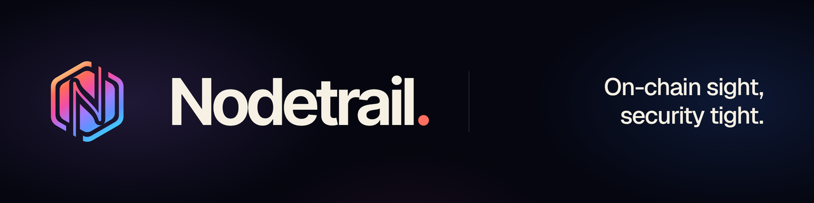

  

# Nodetrail

Nodetrail is a read-only onchain checker for Solana tokens and the wallets that created them.

**On-chain sight, security tight.**

## What we do

- Check a Solana token and the wallet that created it, in seconds, at [nodetrail.io](https://nodetrail.io) or with [@nodetrailbot](https://t.me/nodetrailbot)
- Read the onchain trail: the creator wallet, fees claimed and creator sales, mint and freeze authority, and top holders
- Stay read-only — no wallet connect, no signatures, and we never ask for a seed phrase
- Link out to Solscan and DexScreener so you can verify the same facts

## Official links

[Site](https://nodetrail.io) · [X](https://x.com/nodetrailio) · [Telegram](https://t.me/nodetrailio) · [Bot](https://t.me/nodetrailbot) · [Discord](https://discord.gg/aPYz2NN7gC) · [GitHub](https://github.com/nodetrailio) · [Security](https://nodetrail.io/security)

## Security

The checker engine is private. We never message you first, and we never ask for a seed phrase, private keys, or a wallet connect.

Report impersonators and issues at [nodetrail.io/security](https://nodetrail.io/security).
